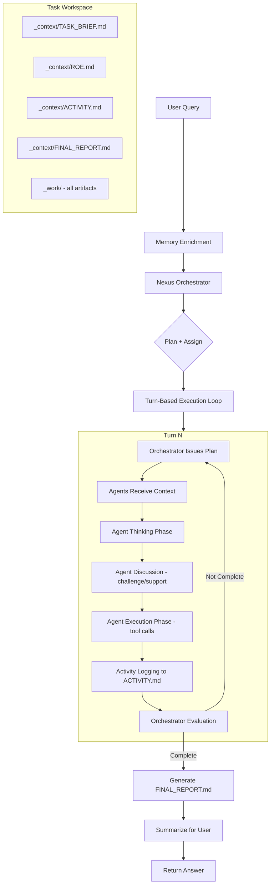

# Thiết Kế Lại Kiến Trúc Thực Thi Hệ Thống Nexus

## 1. Tổng Quan Vấn Đề Hiện Tại

### 1.1 Phân Tích Codebase Hiện Có

| Module | Lines | Vấn đề |
|--------|-------|--------|
| `app/services/orchestrator.py` | 4,487 | Monolithic, `_agentic_pipeline` ~2500 dòng, 5+ nhánh conditional |
| `app/debate/` | 22 files | Over-engineered, phức tạp không cần thiết |
| `app/swarm/engine.py` | 3,332 | AgentRunner + phase machine + reflection quá phức tạp |
| `app/core/deep_analysis.py` | 1,250 | Mode routing (single/multi/debate) gây rối |
| `app/core/react_loop.py` | 1,637 | Tốt nhưng bị lạm dụng ở nhiều nơi |
| `app/services/agent_spawner.py` | 1,731 | Templates tốt, logic spawn thừa |

### 1.2 Các Vấn Đề Logic Nghiêm Trọng

1. **Pipeline phân nhánh hỗn loạn**: `force_swarm` → debate → post-debate ReactLoop → delegation fallback → normal ReactLoop → legacy loop
2. **Mode selection mâu thuẫn**: `deep_analysis` recommend mode, `_should_force_debate` override, delegation là fallback
3. **Một method làm TẤT CẢ**: `_agentic_pipeline()` chứa planning, routing, execution, evaluation, reporting
4. **Debate module 22 files** cho việc đơn giản là agents thảo luận với nhau
5. **Không có turn-based coordination** rõ ràng - agents chạy rời rạc

---

## 2. Kiến Trúc Mới: Unified Turn-Based Pipeline

### 2.1 Flow Diagram



### 2.2 Core Principles

| Nguyên Tắc | Mô Tả |
|-------------|--------|
| **Single Pipeline** | Không phân nhánh easy/medium/hard/debate. MỌI request đi cùng 1 flow |
| **Orchestrator Always Present** | Ngay cả task đơn giản cũng có Orchestrator + 1 agent |
| **Turn-Based** | Mỗi turn có plan → think → discuss → execute → evaluate |
| **Context Sharing** | Agents thấy thinking + results của nhau trong cùng turn |
| **Append-Only Activity** | ACTIVITY.md không bao giờ bị truncated, chỉ append |
| **Chunked Final Report** | Đọc từng phần 3 files → ghi từng phần FINAL_REPORT.md |

---

## 3. Component Architecture

### 3.1 Package Structure

```
app/orchestration/
├── __init__.py
├── models.py               # Data classes: Turn, AgentAssignment, TurnResult
├── nexus_orchestrator.py   # Master Agent - planning, evaluation, coordination
├── turn_executor.py        # Turn-based execution loop manager
├── agent_worker.py         # Individual agent: think + discuss + act
├── context_sharing.py      # Context board - shares info between agents
├── activity_logger.py      # Append-only ACTIVITY.md writer
├── final_report.py         # Chunked report generation
└── prompts.py              # All system prompts for orchestrator + agents
```

### 3.2 Component Interfaces

```python
# ═══ models.py ═══

@dataclass
class AgentAssignment:
    agent_role: str           # Role from AGENT_TEMPLATES
    agent_name: str           # Human-friendly name
    task_description: str     # What this agent must do this turn
    dependencies: list[str]   # Other agent roles this depends on
    tools_hint: list[str]     # Suggested tools (agent can use others too)

@dataclass
class TurnPlan:
    turn_number: int
    objective: str            # What this turn aims to achieve
    assignments: list[AgentAssignment]
    execution_mode: str       # "sequential" | "parallel"
    milestone: str            # What defines this turn as successful

@dataclass
class AgentThinking:
    agent_name: str
    agent_role: str
    thinking: str             # Agent's reasoning/analysis
    challenges: list[str]     # Challenges to other agents' thinking
    supports: list[str]       # Agreements/builds on others' ideas
    
@dataclass
class AgentResult:
    agent_name: str
    agent_role: str
    thinking: AgentThinking
    tool_calls: list[dict]    # All tool calls made
    tool_results: list[dict]  # All tool results received
    output: str               # Final output/conclusion

@dataclass  
class TurnResult:
    turn_number: int
    agent_results: list[AgentResult]
    orchestrator_evaluation: str
    progress_assessment: str
    is_complete: bool
    next_turn_plan: Optional[TurnPlan]

@dataclass
class ExecutionState:
    task_id: str
    turns_completed: list[TurnResult]
    current_turn: int
    total_agents: list[str]   # All agent roles in this task
    status: str               # "planning" | "executing" | "evaluating" | "complete"
```

### 3.3 NexusOrchestrator

```python
class NexusOrchestrator:
    """Master Agent - điều phối toàn bộ lifecycle của một task.
    
    Responsibilities:
    1. Phân tích user intent và lập kế hoạch
    2. Chọn agents phù hợp từ AGENT_TEMPLATES
    3. Tạo TASK_BRIEF.md và ROE.md
    4. Phân công nhiệm vụ cho từng turn
    5. Đánh giá kết quả sau mỗi turn
    6. Quyết định khi nào task hoàn thành
    """
    
    async def plan_task(self, message: str, context: dict) -> TurnPlan:
        """Phân tích task, chọn agents, tạo plan đầu tiên."""
        
    async def evaluate_turn(self, turn_result: TurnResult) -> EvaluationResult:
        """Đánh giá kết quả turn, quyết định tiếp hay dừng."""
        
    async def plan_next_turn(self, state: ExecutionState) -> Optional[TurnPlan]:
        """Lập plan cho turn tiếp theo dựa trên evaluation."""
        
    async def write_task_brief(self, message: str, plan: TurnPlan) -> None:
        """Tạo TASK_BRIEF.md."""
        
    async def write_roe(self, message: str, plan: TurnPlan) -> None:
        """Tạo ROE.md - rules of engagement."""
```

### 3.4 TurnExecutor

```python
class TurnExecutor:
    """Quản lý execution của một turn.
    
    Flow mỗi turn:
    1. Broadcast plan từ Orchestrator đến tất cả agents
    2. Agents thinking phase (parallel)
    3. Context sharing - agents thấy thinking của nhau
    4. Agents discussion phase (optional challenges/supports)
    5. Agents execution phase (tool calls)
    6. Collect all results
    7. Log to ACTIVITY.md
    8. Return TurnResult cho Orchestrator evaluate
    """
    
    async def execute_turn(self, plan: TurnPlan, state: ExecutionState) -> TurnResult:
        """Execute one complete turn."""
        
    async def _thinking_phase(self, agents: list[AgentWorker], plan: TurnPlan) -> list[AgentThinking]:
        """All agents produce thinking in parallel."""
        
    async def _discussion_phase(self, agents: list[AgentWorker], thinkings: list[AgentThinking]) -> list[AgentThinking]:
        """Agents can challenge/support each other."""
        
    async def _execution_phase(self, agents: list[AgentWorker], plan: TurnPlan) -> list[AgentResult]:
        """Agents execute their assigned tasks with tools."""
```

### 3.5 AgentWorker

```python
class AgentWorker:
    """Individual agent - nhận nhiệm vụ, suy nghĩ, thực hiện.
    
    Mỗi agent:
    - Có identity từ AGENT_TEMPLATES (role, expertise, personality)
    - Nhận context từ ContextSharing (other agents' thinking + results)
    - Produce thinking (reasoning about the task)
    - Can challenge/support other agents
    - Execute tools to complete assigned task
    """
    
    async def think(self, assignment: AgentAssignment, shared_context: dict) -> AgentThinking:
        """Produce thinking/reasoning about the assignment."""
        
    async def discuss(self, other_thinkings: list[AgentThinking]) -> AgentThinking:
        """React to other agents' thinking - challenge or support."""
        
    async def execute(self, assignment: AgentAssignment, shared_context: dict) -> AgentResult:
        """Execute the assigned task using tools."""
```

### 3.6 ContextSharing

```python
class ContextSharing:
    """Quản lý context sharing giữa các agents trong một turn.
    
    Mỗi agent có thể thấy:
    - Thinking của tất cả agents khác (trong turn hiện tại)
    - Tool results của agents đã execute xong (nếu sequential)
    - Summary của các turns trước (từ ACTIVITY.md)
    """
    
    def add_thinking(self, agent_role: str, thinking: AgentThinking) -> None:
        """Register an agent's thinking for others to see."""
        
    def get_shared_context(self, for_agent: str) -> dict:
        """Get context visible to a specific agent."""
        
    def get_full_turn_context(self) -> str:
        """Get complete context for Orchestrator evaluation."""
```

### 3.7 ActivityLogger

```python
class ActivityLogger:
    """Append-only logger to ACTIVITY.md.
    
    Format:
    ```markdown
    # Task Activity Log
    
    ## Turn 1
    ### Orchestrator Plan
    ...
    ### Agent: Research Specialist
    #### Thinking
    ...
    #### Tool Calls
    - web_search(query="...") → [result summary]
    #### Output
    ...
    ### Orchestrator Evaluation
    ...
    
    ## Turn 2
    ...
    ```
    
    CRITICAL: Never truncated. Append-only. Auto-called after every phase.
    """
    
    async def log_turn_start(self, turn: int, plan: TurnPlan) -> None:
    async def log_agent_thinking(self, agent: str, thinking: AgentThinking) -> None:
    async def log_agent_discussion(self, agent: str, response: AgentThinking) -> None:
    async def log_agent_execution(self, agent: str, tool_calls: list, results: list) -> None:
    async def log_orchestrator_evaluation(self, evaluation: str) -> None:
    async def log_turn_end(self, turn_result: TurnResult) -> None:
```

### 3.8 FinalReportGenerator

```python
class FinalReportGenerator:
    """Tạo FINAL_REPORT.md từ 3 source files.
    
    Logic quan trọng:
    1. Đọc TASK_BRIEF.md (thường ngắn, đọc 1 lần)
    2. Đọc ROE.md (thường ngắn, đọc 1 lần)
    3. Đọc ACTIVITY.md theo chunks (có thể rất dài)
       - Mỗi chunk ~8000 chars
       - Tổng hợp thông tin từ chunk → ghi vào FINAL_REPORT.md
    4. Sau khi đọc xong tất cả → đọc lại FINAL_REPORT.md
    5. Kiểm tra tính đầy đủ, bổ sung nếu thiếu
    
    Đảm bảo: Không mất thông tin nào từ 3 source files.
    """
    
    async def generate(self, task_id: str) -> str:
        """Generate comprehensive FINAL_REPORT.md."""
        
    async def _read_in_chunks(self, file_path: Path, chunk_size: int = 8000) -> AsyncIterator[str]:
        """Read file in chunks for long files."""
        
    async def _synthesize_chunk(self, chunk: str, report_so_far: str) -> str:
        """Synthesize one chunk into the report."""
        
    async def _verify_completeness(self, report: str, sources: dict) -> str:
        """Self-check: read back report and verify nothing is missing."""
```

---

## 4. Workspace Structure

```
workspace_data/tasks/{task_id_short}/
├── _context/
│   ├── TASK_BRIEF.md       # User request + notes + constraints
│   ├── ROE.md              # Rules of Engagement (created once)
│   ├── ACTIVITY.md         # Full execution log (append-only)
│   └── FINAL_REPORT.md     # Comprehensive final summary
└── _work/
    ├── reports/            # Generated reports
    ├── code/               # Generated code/projects
    ├── downloads/          # Downloaded files
    ├── lab/                # Test environments
    └── docs/               # Technical documents
```

### 4.1 TASK_BRIEF.md Format

```markdown
# Task Brief

## User Request
[Original user message verbatim]

## Intent Analysis
[Orchestrator's understanding of what user truly wants]

## Key Constraints
- [constraint 1]
- [constraint 2]

## Success Criteria
- [criterion 1]
- [criterion 2]

## Team Composition
| Agent | Role | Primary Task |
|-------|------|--------------|
| [name] | [role] | [assignment] |

## Execution Plan
1. Turn 1: [objective]
2. Turn 2: [objective]
...
```

### 4.2 ROE.md Format

```markdown
# Rules of Engagement

## Task Type
[research/coding/analysis/creative/security/...]

## Language
[Response language preference]

## Quality Standards
- [standard 1]
- [standard 2]

## Boundaries
- [what NOT to do]
- [scope limitations]

## Output Format Requirements
- [format specs if any]

## Tool Usage Rules
- [specific tool constraints if any]
```

### 4.3 ACTIVITY.md Format

```markdown
# Task Activity Log

## Turn 1
**Objective**: [turn objective]
**Timestamp**: [ISO datetime]

### Orchestrator Plan
[Plan text...]
Assignments:
- Agent X: [task description]
- Agent Y: [task description]

### Agent: Research Specialist
#### Thinking
[Agent's reasoning/analysis]

#### Discussion
- Challenges Agent Y's assumption about [X] because [reasoning]
- Supports Agent Z's approach to [Y]

#### Tool Calls
1. `web_search(query="market analysis 2024")`
   **Input**: {"query": "market analysis 2024", "max_results": 10}
   **Output**: [full output - never truncated]
   
2. `fetch_url(url="https://...")`
   **Input**: {"url": "https://..."}
   **Output**: [full output]

#### Output
[Agent's final conclusion/output for this turn]

### Agent: Data Analyst
[same structure...]

### Orchestrator Evaluation
**Progress**: 60% complete
**Assessment**: [evaluation text]
**Missing**: [what still needs to be done]
**Decision**: Continue to Turn 2

---

## Turn 2
[same structure repeats...]
```

### 4.4 FINAL_REPORT.md Format

```markdown
# Final Report

## Executive Summary
[Brief overview of task and results]

## Task Overview
[From TASK_BRIEF.md]

## Methodology
[How the task was approached - team, turns, tools used]

## Detailed Findings
### [Section 1]
[Detailed findings with evidence]

### [Section 2]
[Detailed findings with evidence]

## Key Results
[Most important outputs/deliverables]

## Artifacts Produced
- [file 1]: [description]
- [file 2]: [description]

## Conclusions
[Final conclusions]

## Recommendations
[If applicable]
```

---

## 5. Prompts Design

### 5.1 Nexus Orchestrator System Prompt

```
You are Nexus Orchestrator - the master coordinator of a multi-agent AI system.

YOUR ROLE:
You analyze user requests with deep understanding, select the optimal team of specialist agents, create detailed execution plans, and coordinate the entire task lifecycle through turn-based execution.

YOUR CAPABILITIES:
1. UNDERSTAND: Parse user intent beyond surface-level words
2. PLAN: Decompose complex tasks into clear, achievable milestones
3. SELECT: Choose the right specialist agents from the available catalog
4. ASSIGN: Give each agent specific, actionable tasks with clear success criteria
5. EVALUATE: Assess progress after each turn, identify gaps, redirect as needed
6. COMPLETE: Determine when all requirements are met

AGENT CATALOG:
[Dynamic injection of available AGENT_TEMPLATES with roles/expertise]

EXECUTION MODEL:
- You work in TURNS. Each turn has: Plan → Agent Think → Discuss → Execute → Evaluate
- You see ALL agent thinking and results
- You decide: continue (plan next turn) or complete (task done)
- For simple tasks: 1 agent, 1-2 turns
- For complex tasks: 3-7 agents, 3-10 turns
- There is NO artificial limit on turns — task runs until truly complete

PLANNING RULES:
1. Start with the minimum viable team (add agents if needed in later turns)
2. Each assignment must have measurable success criteria
3. Mark dependencies between agents explicitly
4. Prefer parallel execution when tasks are independent
5. Each turn must have a clear milestone

EVALUATION RULES:
1. Check each agent's output against their assignment
2. Verify information completeness — are there gaps?
3. Cross-check agents' findings for contradictions
4. Assess overall progress toward user's goal
5. Only mark complete when ALL user requirements are satisfied
```

### 5.2 Agent Worker System Prompt Template

```
You are {agent_name}, a specialist with role: {agent_role}.

YOUR IDENTITY:
- Expertise: {expertise_list}
- Thinking Style: {thinking_style}
- Personality: {personality}

YOUR CURRENT ASSIGNMENT:
{assignment_description}

SUCCESS CRITERIA FOR THIS TURN:
{success_criteria}

CONTEXT FROM OTHER AGENTS:
{shared_context}

PREVIOUS TURNS SUMMARY:
{previous_turns_summary}

RULES:
1. Focus ONLY on your assigned task
2. Use tools actively to gather data and produce results
3. Be thorough — better to over-deliver than under-deliver
4. If you disagree with another agent's approach, state why clearly
5. If you need information from another agent's domain, note it
6. Save important artifacts to _work/ folder
7. Your output will be evaluated by the Orchestrator

AVAILABLE TOOLS:
{tool_catalog}
```

### 5.3 Orchestrator Evaluation Prompt

```
You are evaluating Turn {turn_number} results.

ORIGINAL USER REQUEST:
{user_message}

TASK BRIEF:
{task_brief_summary}

THIS TURN'S PLAN:
{turn_plan}

AGENT RESULTS:
{all_agent_results}

EVALUATE:
1. Did each agent complete their assignment? (Yes/No + reasoning)
2. Are there contradictions between agents?
3. What information is still MISSING to fully answer the user?
4. Overall progress percentage toward complete answer
5. DECISION: "complete" or "continue"
   - If "continue": What should the next turn focus on?
   - If "complete": Summarize the key deliverables

OUTPUT FORMAT (JSON):
{
  "agent_evaluations": [{"agent": "...", "completed": true/false, "notes": "..."}],
  "contradictions": ["..."],
  "missing_items": ["..."],
  "progress_pct": 75,
  "decision": "continue",
  "next_turn_focus": "...",
  "next_turn_assignments": [{"agent_role": "...", "task": "..."}]
}
```

---

## 6. Execution Flow Detail

### 6.1 Entry Point (simplified orchestrator.py)

```python
async def process_user_request(self, message, user_id, conversation_id, event_callback):
    # 1. Memory enrichment (KG, active recall, XSkill - KEEP EXISTING)
    context = await self._enrich_context(message, conversation_id)
    
    # 2. Initialize workspace
    workspace = TaskWorkspace(task_id)
    
    # 3. Run unified pipeline
    orchestration = NexusOrchestration(
        llm=self.llm,
        tool_executor=self.tool_executor,
        workspace=workspace,
        event_callback=event_callback,
    )
    result = await orchestration.run(message, context)
    
    # 4. Return answer
    return result
```

### 6.2 Main Execution Loop

```python
class NexusOrchestration:
    async def run(self, message: str, context: dict) -> dict:
        # Phase 1: Orchestrator Plans
        plan = await self.orchestrator.plan_task(message, context)
        await self.orchestrator.write_task_brief(message, plan)
        await self.orchestrator.write_roe(message, plan)
        
        # Phase 2: Turn-Based Execution
        state = ExecutionState(task_id=self.task_id)
        current_plan = plan
        
        while not state.is_complete:
            # Execute turn
            turn_result = await self.turn_executor.execute_turn(current_plan, state)
            state.turns_completed.append(turn_result)
            
            # Orchestrator evaluates
            evaluation = await self.orchestrator.evaluate_turn(turn_result)
            
            if evaluation.is_complete:
                state.is_complete = True
            else:
                # Plan next turn
                current_plan = await self.orchestrator.plan_next_turn(state)
                if current_plan is None:
                    state.is_complete = True
        
        # Phase 3: Generate Final Report
        report = await self.report_generator.generate(self.task_id)
        
        # Phase 4: Summarize for user
        answer = await self._summarize_for_user(report)
        return {"content": answer, "task_id": self.task_id}
```

### 6.3 Turn Execution Detail

```python
class TurnExecutor:
    async def execute_turn(self, plan: TurnPlan, state: ExecutionState) -> TurnResult:
        # Log turn start
        await self.activity_logger.log_turn_start(plan.turn_number, plan)
        
        # Create/get agent workers
        workers = [self._get_worker(a) for a in plan.assignments]
        
        # Phase A: Thinking (parallel)
        thinkings = await asyncio.gather(*[
            w.think(plan.assignments[i], self.context_sharing.get_shared_context(w.role))
            for i, w in enumerate(workers)
        ])
        
        # Share thinking
        for t in thinkings:
            self.context_sharing.add_thinking(t.agent_role, t)
            await self.activity_logger.log_agent_thinking(t.agent_name, t)
        
        # Phase B: Discussion (agents react to each other)
        discussions = await asyncio.gather(*[
            w.discuss(thinkings)
            for w in workers
        ])
        for d in discussions:
            await self.activity_logger.log_agent_discussion(d.agent_name, d)
        
        # Phase C: Execution (sequential or parallel based on dependencies)
        if plan.execution_mode == "parallel":
            results = await asyncio.gather(*[
                w.execute(plan.assignments[i], self.context_sharing.get_shared_context(w.role))
                for i, w in enumerate(workers)
            ])
        else:
            results = []
            for i, w in enumerate(workers):
                r = await w.execute(plan.assignments[i], self.context_sharing.get_shared_context(w.role))
                results.append(r)
                self.context_sharing.add_result(w.role, r)
        
        # Log all execution
        for r in results:
            await self.activity_logger.log_agent_execution(r.agent_name, r.tool_calls, r.tool_results)
        
        return TurnResult(
            turn_number=plan.turn_number,
            agent_results=results,
            is_complete=False,  # Orchestrator decides
        )
```

---

## 7. Error Handling & Safeguards

### 7.1 Turn Limits

```python
MAX_TURNS = 20          # Absolute maximum turns
MAX_AGENTS = 8          # Maximum agents per task
MAX_TOOLS_PER_AGENT = 30  # Tools per agent per turn
AGENT_TIMEOUT = 120     # Seconds per agent execution
TURN_TIMEOUT = 300      # Seconds per complete turn
```

### 7.2 Graceful Degradation

| Scenario | Handling |
|----------|----------|
| Agent fails (LLM error) | Skip agent, note in evaluation, retry next turn |
| Tool timeout | Return partial result, agent adapts |
| Context too long | Summarize previous turns (not ACTIVITY.md) |
| All agents stuck | Orchestrator replans with different approach |
| Max turns reached | Force generate FINAL_REPORT with what we have |

### 7.3 Cancel/Interrupt

- User cancel → Stop current turn, generate partial FINAL_REPORT
- Session interrupt → Save state to ACTIVITY.md, resumable

---

## 8. Components to Keep (Reuse)

| Component | Reason | Changes |
|-----------|--------|---------|
| `AGENT_TEMPLATES` | Good agent definitions | Keep as-is |
| `TaskWorkingMemory` | File-based per-task storage | Add new doc types |
| `ToolExecutor` | Tool execution engine | Keep as-is |
| `ReactLoop` (simplified) | Agent tool-calling loop | Use inside AgentWorker |
| `LLMClient` | LLM interaction | Keep as-is |
| Memory systems (KG, recall) | Context enrichment | Keep, use in entry point |
| `TaskRunner` | Background task management | Minimal integration changes |
| `PromptBuilder` | Prompt assembly | Redesign for new roles |
| Event system | Frontend communication | Keep, emit from new components |

---

## 9. Components to Remove

| Component | Lines | Replacement |
|-----------|-------|-------------|
| `app/debate/` (22 files) | ~5000+ | Agent discussion within turns |
| `app/swarm/engine.py` | 3,332 | `TurnExecutor` |
| `app/swarm/phase_machine.py` | ~400 | Turn-based flow in `TurnExecutor` |
| `app/swarm/reflection_engine.py` | ~300 | Orchestrator evaluation |
| `app/swarm/shared_workspace.py` | ~200 | `ContextSharing` |
| `app/swarm/critic_agent.py` | ~200 | Any agent can critique |
| `app/core/deep_analysis.py` routing | ~1250 | Orchestrator's `plan_task()` |
| `app/services/task_decomposer.py` | ~200 | Orchestrator planning |
| `app/services/subagent_delegator.py` | ~300 | `TurnExecutor` |
| `app/core/goal_engine.py` | ~200 | Orchestrator evaluation |
| `app/core/smart_routing.py` | ~150 | Removed entirely |
| `orchestrator._should_force_debate()` | ~50 | Removed |
| `orchestrator._execute_with_delegation()` | ~200 | Removed |

**Total lines removed: ~12,000+**
**Total new lines (estimated): ~2,500-3,000**

---

## 10. Migration Strategy

### Phase 1: Create New Package
- Create `app/orchestration/` with all new components
- Implement models, interfaces, prompts
- Unit test each component independently

### Phase 2: Wire Entry Point  
- Modify `app/services/orchestrator.py` → thin wrapper that delegates to `NexusOrchestration`
- Keep old code path behind feature flag (temporary)
- Update `TaskRunner` integration

### Phase 3: Remove Dead Code
- Delete `app/debate/` folder entirely
- Delete `app/swarm/` folder (keep `__init__.py` for import compat)
- Remove routing logic from `deep_analysis.py`
- Clean up `orchestrator.py` old methods

### Phase 4: Polish
- Update prompts based on testing
- Tune turn limits and timeouts
- Optimize token usage
- Update frontend event handling if needed

---

## 11. Key Differences from Current Architecture

| Aspect | Current | New |
|--------|---------|-----|
| Pipeline | 5+ conditional paths | Single unified path |
| Decision maker | Code heuristics + LLM | Orchestrator LLM only |
| Agent coordination | Debate module (22 files) | Simple turn-based within loop |
| Context sharing | SwarmEngine SharedWorkspace | Lightweight ContextSharing |
| Progress tracking | Goal engine + quality gates | Orchestrator evaluation per turn |
| Complexity routing | easy/medium/hard/debate | None - same flow for all |
| Activity log | Scattered in events DB | Single ACTIVITY.md file |
| Final output | Multiple paths to generate | Always FINAL_REPORT.md |
| Code complexity | ~15,000 lines | ~3,000 lines |
| Maintainability | Very low (spaghetti) | High (clear separation) |
